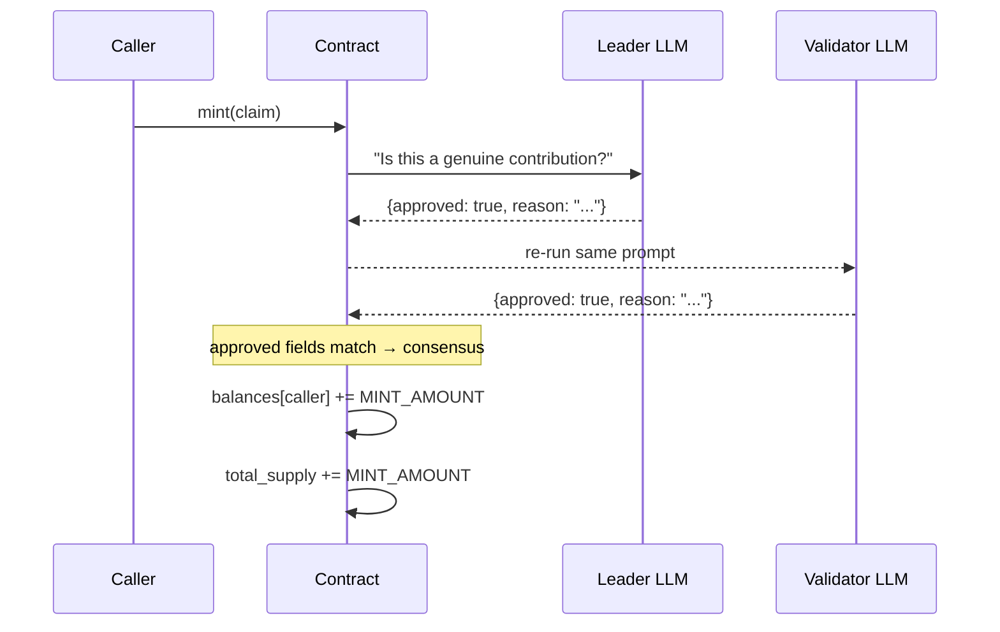

# IntelliPoints — Smart Contract Design Doc

**Status:** Draft  
**Target Chain:** GenLayer (any network)  
**Language / Toolchain:** Python 3 · GenVM SDK (`py-genlayer`)  
**Reviews:** [ ] Design · [ ] Security · [ ] Ops

---

## Action Items (living)

_Empty — fill after each review round._

---

## Goals / Non-Goals

### Goals
- Maintain per-address point balances on-chain, readable by anyone.
- Allow any address to **mint** points to itself via an LLM-judged contribution claim, reaching consensus through the Equivalence Principle.
- Allow any address to **burn** their own points.
- Allow any address to **transfer** points to another address.
- Total supply invariant: `sum(balances) == total_supply` always holds.

### Non-Goals
- No role hierarchy or privileged minter — fully permissionless.
- No cross-chain bridging.
- No governance or voting weight attached to points (yet).
- No rate-limiting or anti-spam beyond LLM consensus cost.

---

## Requirements

### Functional
1. `balanceOf(address)` returns current point balance for any address.
2. `totalSupply()` returns the global sum of all points minted minus burned.
3. `mint(claim)` — caller submits a free-text contribution claim; the LLM judges it; if accepted, `MINT_AMOUNT` points are credited to the caller.
4. `transfer(to, amount)` — moves `amount` points from caller to `to`; reverts if caller balance is insufficient.
5. `burn(amount)` — destroys `amount` points from caller; reverts if insufficient balance.

### Security
- No path lets an address mint points without a majority of validators accepting the LLM judgment.
- No path lets an address spend more than their balance.
- No path lets an address burn another address's points.
- The LLM validator re-runs the judgment independently; it does not merely format-check the leader's answer.

---

## Terminology & Actors

| Term | Definition |
|------|-----------|
| Claim | Free-text string describing a contribution the caller asserts they made |
| MINT_AMOUNT | Fixed number of points awarded for an accepted claim (100) |
| Validator | GenLayer network node that independently re-evaluates the LLM judgment |
| Leader | First validator to propose the LLM result; others verify it |

| Actor | On/Off-chain | Trust level | What they can do |
|-------|-------------|-------------|-----------------|
| Any address | On-chain | Untrusted | Submit mint claims, transfer/burn own points |
| GenLayer validators | On-chain infrastructure | Trusted (network-level) | Execute & verify LLM equivalence judgment |
| LLM | Off-chain service | Semi-trusted (validated by consensus) | Judge whether a claim describes a genuine contribution |

---

## Language / Runtime

- **Language:** Python 3 (GenVM SDK)
- **Runner:** `py-genlayer:1jb45aa8ynh2a9c9xn3b7qqh8sm5q93hwfp7jqmwsfhh8jpz09h6` (pinned — networks reject `test`/`latest`)
- **Storage types:** `TreeMap[Address, u256]` for balances; `u256` for total supply
- **EVM equivalent:** None — this is a native GenLayer Python contract

---

## Transaction & Execution Model

GenLayer transactions are queued per-contract and executed sequentially. A randomly chosen leader runs the contract code first; validators re-run and must agree (or be within tolerance) for the transaction to commit. If consensus is not reached the transaction goes undetermined — state is NOT modified.

For `mint`:  
1. Leader calls `gl.vm.run_nondet_unsafe(leader_fn, validator_fn)`.  
2. `leader_fn` prompts the LLM to judge the claim → returns `True`/`False`.  
3. `validator_fn` independently re-runs the same LLM task; compares the `approved` field of both results. Agreement → accept; disagreement → reject.  
4. Only if consensus agrees the claim is valid does state (balances, total_supply) get updated.

---

## Architecture Overview

**Resting-state invariant:** `sum(all balances) == total_supply` at end of every transaction.

---

## Contract Design

### Storage

| Variable | Type | Description |
|----------|------|-------------|
| `balances` | `TreeMap[Address, u256]` | Point balance per address |
| `total_supply` | `u256` | Sum of all minted minus burned points |

### Functions

#### Read (view)
| Name | Returns | Description |
|------|---------|-------------|
| `balance_of(account)` | `u256` | Balance of given address |
| `total_supply()` | `u256` | Global total supply |

#### Write
| Name | Caller | State mutated | Revert conditions |
|------|--------|---------------|-------------------|
| `mint(claim)` | Any | `balances[sender] += MINT_AMOUNT`, `total_supply += MINT_AMOUNT` | LLM consensus rejects claim |
| `transfer(to, amount)` | Any | `balances[sender] -= amount`, `balances[to] += amount` | `amount == 0`; sender balance < amount; `to == sender` |
| `burn(amount)` | Any | `balances[sender] -= amount`, `total_supply -= amount` | `amount == 0`; sender balance < amount |

---

## Equivalence Principle Pattern

`mint` uses a **custom validator function** (`run_nondet_unsafe`) — the most robust pattern:

- **Leader:** prompts LLM with a structured JSON-output task; parses `approved` field.
- **Validator:** independently re-runs the same prompt; compares `approved` field of leader vs validator result.
- If both agree on `approved == True` → claim passes.
- If either disagrees → transaction goes undetermined (no state change).

This satisfies the independent-verification requirement: the validator does not only check that the leader produced valid JSON; it generates its own independent verdict.

---

## Security Considerations

| Vulnerability | Applicable? | Mitigation |
|---------------|-------------|-----------|
| LLM manipulation / prompt injection | Yes | Prompt is constructed server-side from structured inputs; claim text is treated as a plain string literal, not code or system instruction |
| Leader-only validation | Yes — guarded | Custom validator re-runs LLM independently; it does not trust the leader's answer |
| Overspend / underflow | Yes | Explicit balance checks before transfer and burn |
| Reentrancy | N/A | GenLayer has no cross-contract call in this contract |
| Access control | N/A | Fully permissionless; no privileged roles |
| Sybil / spam minting | Partial | Each mint requires validator consensus; spamming is rate-limited by network cost, not by code |
| Integer overflow | Guarded | `u256` type; GenVM enforces bounds |
| Non-determinism escape | Yes — guarded | All LLM calls inside `run_nondet_unsafe` block; storage inaccessible from non-det block |

---

## Upgradeability

Not upgradeable. GenLayer does not have an EVM-style proxy pattern. Migration path: deploy a new contract, snapshot balances off-chain via view calls, and migrate manually.

---

## Testing Strategy

- **Unit:** Deploy in GenLayer Studio local environment; call each method with valid and invalid inputs; assert balance invariants.
- **Consensus simulation:** Use GenLayer Studio's multi-validator simulation to verify the LLM equivalence path accepts good claims and rejects nonsense claims.
- **Invariant:** After every sequence of operations, assert `sum(balances.values()) == total_supply`.
- **Adversarial:** Submit claims designed as prompt-injection attempts; verify they are judged correctly or rejected.

---

## Deployment

1. Open the contract file in GenLayer Studio (local or hosted).
2. Deploy with no constructor arguments — `total_supply` starts at 0.
3. Record the deployed contract address.
4. Interact via the Studio Write Methods panel or the GenLayer SDK/CLI.

---

## Priorities & Tradeoffs

| Decision | Tradeoff | Rationale |
|----------|----------|-----------|
| Fixed `MINT_AMOUNT = 100` | Less flexibility vs. dynamic amounts | Eliminates LLM from deciding amount, keeping consensus surface minimal |
| `run_nondet_unsafe` vs `prompt_comparative` | More boilerplate; full control | `prompt_comparative` is a convenience wrapper that most production contracts outgrow; explicit validator gives reviewers a clear, auditable comparison rule |
| Fully permissionless mint | Sybil risk | Aligns with the design goal; spam is mitigated by consensus cost |
| No pause mechanism | Harder to halt if exploited | Simplicity; no privileged roles exist to call pause |
