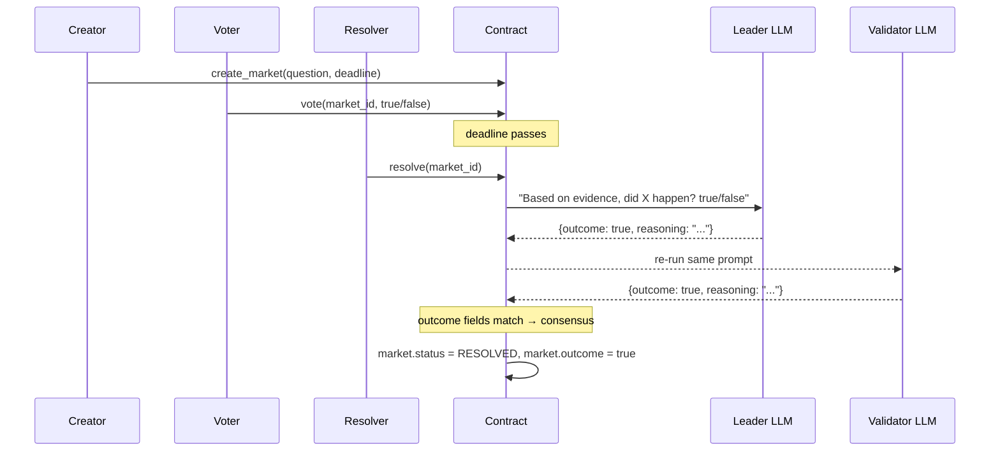

# PredictionMarket — Smart Contract Design Doc

**Status:** Draft  
**Target Chain:** GenLayer (Studionet / any network)  
**Language / Toolchain:** Python 3 · GenVM SDK (`py-genlayer`)  
**Reviews:** [ ] Design · [ ] Security · [ ] Ops

---

## Action Items (living)

_Empty — fill after each review round._

---

## Goals / Non-Goals

### Goals
- Allow any address to **create** a yes/no prediction market with a question and a resolution deadline.
- Allow any address to **vote** YES or NO on an open market before the deadline.
- Allow any address to **resolve** a market after its deadline via LLM + web evidence, reaching consensus through the Equivalence Principle.
- Store the settled outcome (`true`/`false`/`undetermined`) on-chain immutably once resolved.
- Expose per-market vote tallies and outcomes as read-only views.

### Non-Goals
- No token staking or prize distribution (outcome storage only — no funds custody).
- No cross-chain bridging.
- No appeal mechanism in v1.
- No oracle integration beyond the LLM.

---

## Requirements

### Functional
1. `create_market(question, deadline)` — creates a new market; `deadline` is a Unix timestamp (int).
2. `vote(market_id, position)` — records caller's YES/NO vote; fails after deadline or if already resolved.
3. `resolve(market_id)` — callable by anyone after deadline; uses `run_nondet_unsafe` to fetch evidence and judge the outcome; sets market status to RESOLVED with outcome `true`/`false`, or leaves it UNDETERMINED if consensus fails.
4. `get_market(market_id)` — returns market details: question, deadline, vote counts, status, outcome.
5. `get_vote(market_id, account)` — returns a given address's vote.

### Security
- No path lets a market be resolved before its deadline.
- No path lets a market be resolved twice.
- No path lets a caller vote twice on the same market.
- The LLM validator re-runs independently; it does not merely format-check the leader's answer.
- Resolution outcome is immutable once set.

---

## Terminology & Actors

| Term | Definition |
|------|-----------|
| Market | A yes/no question with a deadline and accumulated votes |
| Position | YES (`true`) or NO (`false`) |
| Resolution | The settled outcome of a market after its deadline, determined by LLM consensus |
| OPEN | Market is accepting votes, deadline not yet passed |
| PENDING | Deadline passed, not yet resolved |
| RESOLVED | Outcome settled by consensus |

| Actor | On/Off-chain | Trust level | What they can do |
|-------|-------------|-------------|-----------------|
| Any address | On-chain | Untrusted | Create markets, vote, trigger resolution |
| GenLayer validators | On-chain infrastructure | Trusted (network-level) | Execute & verify LLM equivalence judgment |
| LLM | Off-chain service | Semi-trusted (validated by consensus) | Judge the outcome from web evidence |

---

## Language / Runtime

- **Language:** Python 3 (GenVM SDK)
- **Runner:** `py-genlayer:1jb45aa8ynh2a9c9xn3b7qqh8sm5q93hwfp7jqmwsfhh8jpz09h6` (pinned)
- **Storage types:** `TreeMap[u256, Market]` for markets; `TreeMap[Address, bool]` per market for votes; `u256` counter for market IDs
- **EVM equivalent:** None — native GenLayer Python contract

---

## Transaction & Execution Model

GenLayer transactions are queued per-contract and executed sequentially. For `resolve`:

1. Leader runs `leader_fn`: prompts the LLM with the market question and asks for a JSON verdict.
2. Each `validator_fn`: independently re-runs the same LLM prompt, compares the `outcome` field with the leader's.
3. If both agree → outcome committed to storage.
4. If they disagree → transaction goes undetermined; market stays PENDING and can be retried.

---

## Architecture Overview

---

## Contract Design

### Storage

| Variable | Type | Description |
|----------|------|-------------|
| `markets` | `TreeMap[u256, Market]` | All markets by ID |
| `market_votes` | `TreeMap[u256, TreeMap[Address, bool]]` | Per-market votes |
| `next_market_id` | `u256` | Auto-incrementing market ID counter |

### Market struct fields

| Field | Type | Description |
|-------|------|-------------|
| `question` | `str` | The yes/no question |
| `deadline` | `u256` | Unix timestamp after which resolution is allowed |
| `creator` | `Address` | Address that created the market |
| `yes_votes` | `u256` | Count of YES votes |
| `no_votes` | `u256` | Count of NO votes |
| `status` | `str` | "OPEN", "PENDING", or "RESOLVED" |
| `outcome` | `bool` | Final outcome (only valid when RESOLVED) |

### Functions

#### Read (view)
| Name | Returns | Description |
|------|---------|-------------|
| `get_market(market_id)` | `dict` | Full market details |
| `get_vote(market_id, account)` | `str` | "YES", "NO", or "NONE" |
| `get_market_count()` | `u256` | Total markets created |

#### Write
| Name | Caller | State mutated | Revert conditions |
|------|--------|---------------|-------------------|
| `create_market(question, deadline)` | Any | New market entry, `next_market_id++` | Empty question; deadline in the past |
| `vote(market_id, position)` | Any | `yes_votes` or `no_votes` incremented; vote recorded | Market not found; deadline passed; already voted |
| `resolve(market_id)` | Any | `status = RESOLVED`, `outcome = bool` | Market not found; deadline not passed; already resolved |

---

## Equivalence Principle Pattern

`resolve` uses `run_nondet_unsafe`:

- **Leader:** asks the LLM to judge the market question based on available knowledge; returns `{outcome: bool, reasoning: str}`.
- **Validator:** independently re-runs the identical prompt; compares the `outcome` boolean of both results.
- Agreement on `outcome` → accepted; disagreement → undetermined (market stays PENDING, can be retried).

---

## Security Considerations

| Vulnerability | Applicable? | Mitigation |
|---------------|-------------|-----------|
| Early resolution | Yes — guarded | `resolve` checks `gl.message.timestamp >= market.deadline` |
| Double resolution | Yes — guarded | Check `market.status != "RESOLVED"` before running LLM |
| Double voting | Yes — guarded | Per-market vote map; revert if address already has entry |
| LLM manipulation | Yes | Question stored on-chain verbatim; prompt constructed server-side |
| Leader-only validation | Yes — guarded | Validator re-runs LLM independently |
| Undetermined loop | Partial | If consensus fails repeatedly, market stays PENDING; no state corruption |
| Integer overflow | Guarded | `u256` type |
| Reentrancy | N/A | No external calls; no fund movements |

---

## Upgradeability

Not upgradeable. Migration: deploy a new contract and snapshot state off-chain.

---

## Testing Strategy

- **Unit:** Create markets, vote, resolve — assert status transitions and outcome storage.
- **Consensus simulation:** Use GenLayer Studio multi-validator simulation; verify agreement on clear outcomes.
- **Edge cases:** resolve before deadline (should revert), double vote (should revert), double resolve (should revert).
- **Invariant:** A RESOLVED market's outcome never changes.

---

## Deployment

1. Open in GenLayer Studio.
2. Deploy with no constructor arguments.
3. Call `create_market("Will ETH close above $3000 on Nov 1 2026?", <unix_timestamp>)`.
4. Call `vote(0, true)` from multiple addresses.
5. After deadline, call `resolve(0)` and observe LLM consensus in action.

---

## Priorities & Tradeoffs

| Decision | Tradeoff | Rationale |
|----------|----------|-----------|
| No staking/payouts | Less exciting financially | Keeps contract focused on GenLayer consensus; no fund-custody risk |
| `run_nondet_unsafe` | More boilerplate | Full control over validator comparison logic; production pattern |
| Retryable resolution | Market stays PENDING on undetermined | Safer than forcing an outcome; consensus can be retried |
| Timestamp from `gl.message.timestamp` | Node clock dependency | Standard GenLayer pattern; acceptable for deadline granularity |
